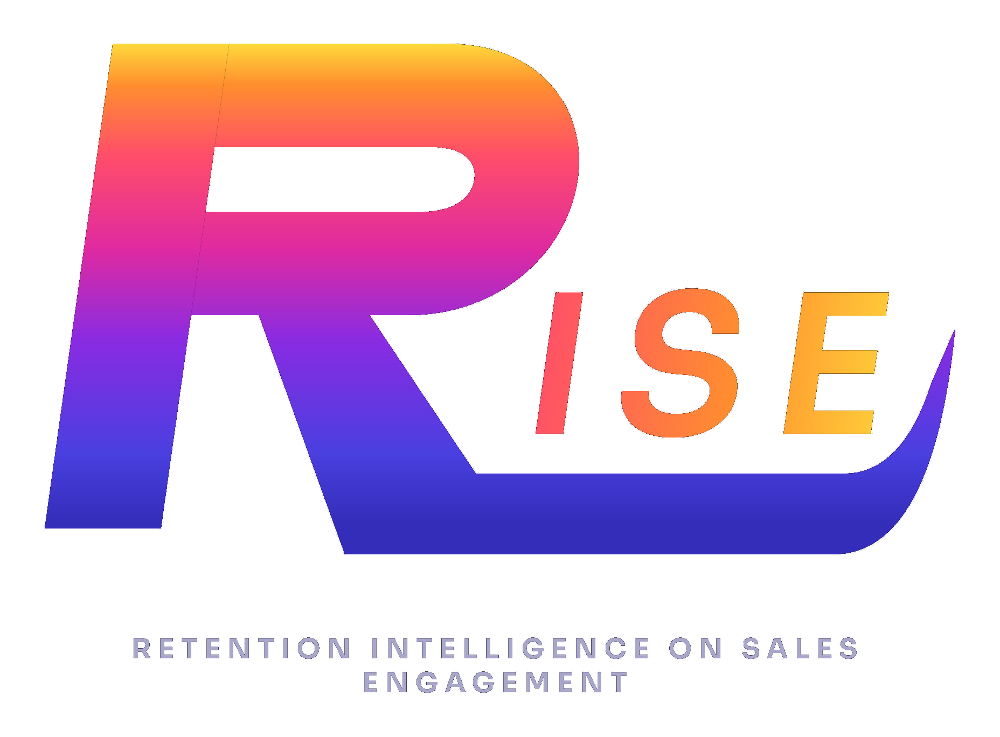

<div align="center">



<br><br>

**Retention Intelligence on Sales Engagement.**
Spot churn before it happens, and know exactly who to call today.

[**Live Demo**](https://retainiq-thunderhacks-2026.vercel.app/) &nbsp;·&nbsp; [**User Guide**](USER_GUIDE.md) &nbsp;·&nbsp; [**Developer Guide**](DEVELOPER_GUIDE.md)

🏆 Gold Sponsor Challenge Winner, ThunderHacks 2026

</div>

---

## Overview

R.I.S.E CRM (formerly RetainIQ) is a customer retention platform built for **Digital Move IT & Telecom** in 24 hours at ThunderHacks 2026.

It scores churn risk for every account in real time, maps each customer's journey, and drafts personalized retention emails with AI, so sales teams stop reacting to churn and start preventing it.

<div align="center">
  
  <br>
  <sub>Winning the Digital Move Gold Sponsor Challenge at ThunderHacks 2026</sub>
</div>

---

## Features

| | |
| :--- | :--- |
| **Dashboard** | Live churn risk across every account, with filters for plan tier and risk level, animated KPI cards and a color-coded chart. |
| **Customer Intelligence** | A sortable, searchable table with sparkline trends, risk bars and plan badges. Click a row for six deep-dive stats, a risk gauge and a journey-stage indicator. |
| **Pipeline Journey Map** | Four stages (Active, At-Risk, Critical, Expired). Click a stage to inspect its cohort, individual risk scores and overall health. |
| **Lifecycle Timeline** | Pick any customer and scroll through a three-act story of their engagement decline. |
| **Alert Center** | The high-priority accounts that need a call today, plus on-demand retention emails written by Groq's Llama 3.3 70B. |

---

## How It Works

```text
Customer data → scikit-learn scoring → 0–100 risk score → Groq (Llama 3.3 70B) → personalized email
```

1. **Scoring:** contract value, time since last contact and days until renewal produce a 0–100 churn risk score and a lifecycle stage for every account.
2. **Outreach:** renewal emails are drafted per account using company name, software, contract expiry, value and account manager. If the AI service is down, a local template takes over, so there is always a usable draft.

---

## Tech Stack

| Layer | Technologies |
| :--- | :--- |
| Frontend | React, Framer Motion, Recharts |
| Backend | Python, Flask, Flask-CORS |
| Data & ML | scikit-learn, Pandas, NumPy |
| Database | SQLite |
| AI | Groq, Llama 3.3 70B |
| Hosting | Vercel (frontend), Render (backend) |

---

## Getting Started

**Prerequisites:** Python 3.10+, Node.js 18+

### 1. Backend

```bash
git clone https://github.com/Runonrise/R.I.S.E-CRM.git
cd R.I.S.E-CRM
pip install -r requirements.txt

# For AI emails, set a Groq API key
export GROQ_API_KEY=your_key_here          # macOS / Linux
$env:GROQ_API_KEY="your_key_here"          # Windows PowerShell

python app.py                              # http://localhost:5000
```

### 2. Frontend

```bash
cd frontend
npm install
npm start                                  # http://localhost:3000
```

> **Demo login (evaluation only):** `digitalmove` / `retainiq2026`

---

## Deployment

- **Frontend:** Vercel. **Backend:** Render.
- The backend seeds a SQLite database from `clients.csv` on every startup, so the demo is never empty. Render's free-tier disk is ephemeral, so records added through the UI do not persist.
- On the free tier the backend sleeps when idle, and the first request can take **60 to 90 seconds**. To wake it before a demo, open [the customers endpoint](https://retainiq-thunderhacks-2026.onrender.com/api/customers).

---
<div align="center">

**Ellison Naz** · **Rishav Bawa** · **Joel Saji Varghese**

<sub>© 2026 Runonrise · Retention Intelligence on Sales Engagement · Not yet an official release</sub>

</div>
